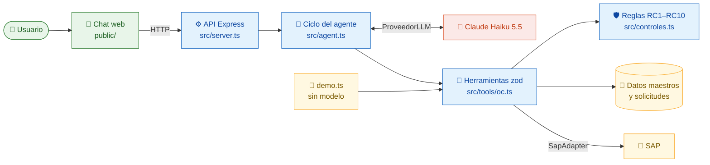

<div align="center">

# 🧾 Agente de Órdenes de Compra SAP

**Agente conversacional con IA que valida solicitudes de compra y crea órdenes de compra en SAP, con control humano en cada excepción.**

[](https://agente-ordenes-compra-nviw.onrender.com)


</div>

---

## ✨ Qué hace

El agente lee el paquete de una solicitud de compra (correo, solicitud, cotización, aprobación y factura), lo valida contra los datos maestros con **10 reglas de control**, construye el payload de la orden de compra, genera la evidencia de aprobación y **crea la OC en SAP**. Cuando hay una duda, se detiene y pide confirmación.

| | Característica | Detalle |
|:-:|---|---|
| 🛡️ | **Reglas deterministas** | Las validaciones son código, no decisiones del modelo: mismos datos → mismo resultado. |
| 🙋 | **Confirmación humana** | Ninguna OC con excepciones se crea sin que el usuario la confirme; el backend lo verifica. |
| 🔁 | **Idempotencia** | Procesar dos veces la misma solicitud devuelve la misma OC, nunca un duplicado. |
| 🔍 | **Trazabilidad** | Cada campo de la OC indica de qué fuente salió, y cada acción queda en un log de auditoría. |
| 🔐 | **Evidencia verificable** | La aprobación se guarda con su huella **SHA-256**. |
| 🔌 | **Arquitectura desacoplada** | El proveedor LLM y SAP están detrás de interfaces propias: se cambian sin tocar el agente. |
| 💰 | **Bajo costo** | ~**USD 0,0015** por solicitud procesada con Claude Haiku. |

---

## 🏗️ Arquitectura



**Principio de diseño:** el modelo conversa y decide qué herramienta usar; **la lógica de negocio vive en las herramientas**. Por eso `demo.ts` procesa todos los casos sin el modelo y obtiene siempre el mismo resultado.

### 🔄 Ciclo del agente

1. El usuario escribe en el chat.
2. El backend envía a Claude el prompt, el historial y las herramientas disponibles.
3. Claude responde con texto o pide ejecutar una herramienta.
4. El backend la ejecuta **pasando por las guardas** y devuelve el resultado.
5. Se repite hasta que Claude responde solo con texto (máximo 25 vueltas).
6. Si hay una excepción, el turno termina con una pregunta y la OC se crea solo si el siguiente mensaje la confirma.

---

## 🛡️ Reglas de control

| Regla | Qué valida | Tipo |
|:-:|---|:-:|
| **RC1** | El proveedor existe (por NIT o por nombre) y está activo | 🔴 Bloqueo |
| **RC2** | La aprobación existe y la emitió un aprobador del centro de costo | 🔴 Bloqueo |
| **RC3** | El monto no supera el tope del aprobador | 🔴 Bloqueo |
| **RC4** | La subárea pertenece al centro de costo | 🔴 Bloqueo |
| **RC5** | La cotización no difiere más del 2 % de la solicitud | 🟡 Confirmación |
| **RC6** | Sin indicador de IVA → se toma el del proveedor | 🔵 Derivado + 🟡 |
| **RC7** | Sin condición de pago → se toma la del proveedor | 🔵 Derivado |
| **RC8** | Factura anterior a la solicitud → compra **retroactiva** | 🟡 Confirmación |
| **RC9** | La aprobación no es anterior a la solicitud | 🟡 Confirmación |
| **RC10** | cantidad × valor unitario = valor total | 🔴 Bloqueo |

Cada bloqueo incluye una **acción sugerida** para el solicitante.

---

## 🧰 Stack tecnológico

| Capa | Tecnología | Uso |
|---|---|---|
| **Runtime** |   | Ejecuta TypeScript directamente, sin paso de compilación |
| **Lenguaje** |  | Tipado estricto en todo el proyecto |
| **Backend** |  | API REST y servidor del chat |
| **Validación** |  | Esquemas de datos, argumentos de herramientas y payload de la OC |
| **IA** |   | Interpretación del lenguaje natural y uso de herramientas |
| **Frontend** |   | Chat ligero, sin frameworks |
| **ERP** |  | Interfaz `SapAdapter` preparada para OData, BAPI o carga por archivo |
| **Despliegue** |   | Despliegue continuo en cada push a `main` |

---

## 🚀 Inicio rápido

> Requiere **Node.js 20+** (probado con Node 24).

```bash
npm install
cp .env.example .env      # completar ANTHROPIC_API_KEY
npm run dev               # chat + API en http://localhost:3000
```

### 🧪 Verificación sin modelo

No requiere ninguna clave:

```bash
npm install && npm run demo
```

Procesa los 6 casos de ejemplo llamando directamente a las herramientas, confirma los pendientes, demuestra la idempotencia y muestra la matriz de controles.

| Comando | Qué hace |
|---|---|
| `npm run dev` | Levanta el servidor con recarga automática |
| `npm run demo` | Ejecuta los 6 casos sin el modelo |
| `npm run verificar` | Valida los datos de ejemplo contra los esquemas zod |
| `npm run typecheck` | Revisa los tipos de TypeScript |
| `npm run modulo` | Genera el módulo reutilizable en `modulo/` |

---

## ⚙️ Variables de entorno

| Variable | Obligatoria | Defecto | Uso |
|---|:-:|---|---|
| `ANTHROPIC_API_KEY` | ✅ (chat) | — | Clave del proveedor LLM. Solo vive en el backend. |
| `LLM_PROVIDER` | — | `anthropic` | Implementación del adaptador LLM |
| `ANTHROPIC_MODEL` | — | `claude-haiku-5-5` | Modelo |
| `MAX_ITERACIONES` | — | `25` | Tope de vueltas por turno |
| `MAX_TOKENS_SESION` | — | `300000` | Tope de tokens por sesión |
| `LLM_TIMEOUT_MS` | — | `60000` | Timeout por llamada al modelo |
| `PORT` | — | `3000` | Puerto HTTP |

---

## 🔗 API

| Método | Ruta | Cuerpo → respuesta |
|:-:|---|---|
|  | `/api/chat` | `{ sessionId, message }` → `{ reply, toolCalls[], needsConfirmation, uso }` |
|  | `/api/sessions/:id` | Historial de la sesión (mensajes, herramientas y confirmaciones) |
|  | `/api/health` | `{ ok: true, provider, model }` (sin claves) |
|  | `/api/ordenes` | Órdenes de compra creadas |

`toolCalls[]` tiene la forma `{ herramienta, args, ok, resultado }`. Si `needsConfirmation` es `true`, el agente terminó el turno con una pregunta y solo creará la OC si el siguiente mensaje confirma ("Confirmo").

---

## 📁 Estructura

```
├── agent/prompt.md          🧭 Comportamiento del agente (system prompt)
├── src/
│   ├── knowledge/           📚 Conocimiento del proceso de compras
│   ├── tools/oc.ts          🧰 Herramientas zod: leer, validar, construir, evidenciar, crear
│   ├── tools/index.ts       📝 Registro, validación de argumentos y log de llamadas
│   ├── agent.ts             🔄 Ciclo del agente y confirmación humana
│   ├── llm/                 🧠 Adaptador del proveedor LLM (interfaz + Anthropic)
│   ├── sap/                 🏢 SapAdapter (interfaz) + implementación local
│   ├── controles.ts         🛡️ Reglas RC1–RC10 (funciones puras)
│   ├── datos.ts             📂 Lectura y normalización de datos
│   ├── payload.ts           📦 Esquema zod de la OC y trazabilidad
│   ├── evidencia.ts         🔐 Evidencia de aprobación con SHA-256
│   └── server.ts            ⚙️ API HTTP
├── public/index.html        💬 Chat web
├── fixtures/reto-03/        🗂️ Maestros y solicitudes de ejemplo
├── modulo/                  📦 Módulo reutilizable (agente + skill + herramientas)
├── demo.ts                  🧪 Verificación sin modelo
└── out/                     📤 Generado en ejecución (no versionado)
```

---

<div align="center">

Desarrollado por **Anderson Sarmiento Briceño**

[](https://github.com/anderson-sarmiento-briceno)
[](https://www.linkedin.com/in/anderson-sarmiento-briceno/)

</div>
